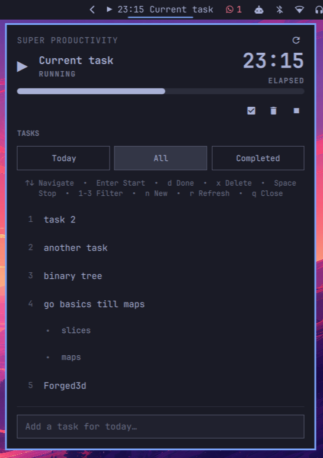

# Super Productivity Omarchy Plugin

A beautiful Omarchy shell plugin that integrates [Super Productivity](https://super-productivity.com/) with your Omarchy desktop environment. Manage tasks, track time, and stay productive without leaving your workflow.



## Features

### 📋 Task Management
- **View Today's Tasks** - See all tasks planned for today
- **Filter Tasks** - Switch between Today, All, and Completed views
- **Start/Stop Timer** - Track time on tasks with a single click
- **Complete Tasks** - Mark tasks as done directly from the panel
- **Delete Tasks** - Remove tasks you no longer need
- **Add New Tasks** - Quick task creation from the panel

### 🎯 Subtask Support
- Parent tasks display with their subtasks nested underneath
- Subtasks are slightly indented with bullet points for visual hierarchy
- Start timers on either parent tasks or subtasks
- All actions (complete, delete, start) work on both levels

### ⏱️ Time Tracking
- **Live Timer Display** - See elapsed time updating every second in both bar and panel
- **Elapsed/Remaining Toggle** - Click the time display to switch between elapsed and remaining time
- **Progress Bar** - Visual indicator when task has a time estimate
- **Negative Time Support** - Shows when you've exceeded your estimate

### ⌨️ Keyboard Navigation
Navigate efficiently without touching your mouse:

- **↑/↓ or j/k** - Navigate through tasks
- **Enter** - Start timer on selected task (or complete if already running)
- **d** - Mark selected task as done
- **x** - Delete selected task
- **1/2/3** - Switch between Today/All/Completed filters
- **Space** - Stop current timer
- **n** - Focus on "Add task" input field
- **r** - Refresh task list
- **q** - Close panel
- **Escape** - Close panel or unfocus input field

### 🎨 Visual Design
- Follows Omarchy's design language
- Hover effects and keyboard cursor highlighting
- Action buttons appear on hover or selection
- Clean, minimal interface that doesn't distract

## Requirements

- Omarchy Linux desktop environment
- [Super Productivity](https://super-productivity.com/) app running
- Super Productivity REST API enabled (Settings > Misc > Enable local REST API)
- `curl` and `python3` (python3 ships with Omarchy)

## Installation

### Via Omarchy Plugin Manager

```bash
omarchy plugin add https://github.com/Apsinghsa/super-productivity-omarchy-plugin.git --enable
```

### Manual Installation

```bash
# Clone to your Omarchy plugins directory
git clone https://github.com/Apsinghsa/super-productivity-omarchy-plugin.git ~/.config/omarchy/plugins/apsingh.super-productivity

# Enable the plugin
omarchy plugin enable apsingh.super-productivity

# Restart the shell
omarchy restart shell
```

## Removal

### Via Omarchy Plugin Manager

```bash
omarchy plugin remove apsingh.super-productivity
```

### Manual Removal

```bash
# Remove the plugin directory
rm -rf ~/.config/omarchy/plugins/apsingh.super-productivity

# Restart the shell
omarchy restart shell
```

## Configuration

The plugin appears in your Omarchy bar. You can customize its position in `~/.config/omarchy/shell.json`:

```json
{
  "bar": {
    "layout": {
      "right": [
        {
          "id": "apsingh.super-productivity"
        }
      ]
    }
  }
}
```

| Key | Type | Default | Description |
|---|---|---|---|
| `apiToken` | string | *(token file)* | Override the REST API token |
| `pollIntervalSec` | integer | 15 | How often to poll the API (seconds, minimum 5) |
| `maxTitleLength` | integer | 32 | Max current-task title length in the bar |

## Security

Plugins run unsandboxed with your user permissions. The token file grants full access to your Super Productivity data — do not share it.

The token is never placed in a process argument list (readable by other local processes via `/proc`). `curl` reads it from a private config file published by `sp-secure.py`, which performs every access through held, owner-validated no-follow descriptors (`openat2` with `RESOLVE_NO_SYMLINKS`/`O_NOFOLLOW`, `fstat` owner and mode checks, `fsync`, descriptor-relative atomic rename into a verified 0700 directory) and refuses the operation when that boundary cannot be established; the token source itself is opened the same way and must be a regular file. Token file reads and API responses are size- and time-bounded. Tokens are validated as 8-128 characters of `[A-Za-z0-9_.-]` before use, so no quote, newline or control character can inject curl config directives. API responses are sanitized into a bounded schema (max 200 tasks, 50 subtasks, capped field lengths, control and markup characters stripped) before reaching the UI, and API text is rendered as plain text.

## Usage

### Bar Widget
The bar widget shows:
- `▶` icon when no task is running
- `▶ MM:SS Task Title` when a task timer is active
- Click to open the task panel
- Right-click to stop the current timer

### Task Panel
Click the bar widget to open the panel:

1. **Current Task Section** - Shows the active task with timer and controls
2. **Filter Buttons** - Switch between Today/All/Completed tasks
3. **Task List** - Scrollable list with hover actions
4. **Add Task Input** - Quick task creation at the bottom

### Time Display Toggle
When a task has a time estimate:
- Click on the time display (in panel) to toggle between elapsed and remaining time
- Both the panel and bar widget update together
- A small label shows "ELAPSED" or "REMAINING" to indicate the current mode

### Keyboard Shortcuts
Press any key to see available shortcuts:
- Navigation: `↑↓` or `jk`
- Actions: `Enter`, `d`, `x`, `Space`
- Filters: `1`, `2`, `3`
- Other: `n`, `r`, `q`, `Escape`

## How It Works

The plugin communicates with Super Productivity via its local REST API:
- **Base URL**: `http://127.0.0.1:3876`
- **Authentication**: Bearer token from Super Productivity settings
- **Endpoints used**:
  - `GET /status` - Get current task and status
  - `GET /tasks` - List tasks with filters
  - `GET /tasks/:id` - Get specific task details
  - `POST /tasks/:id/start` - Start timer on task
  - `POST /task-control/stop` - Stop current timer
  - `PATCH /tasks/:id` - Update task (mark as done)
  - `DELETE /tasks/:id` - Delete task
  - `POST /tasks` - Create new task

## Troubleshooting

### Plugin not showing in bar
```bash
# Check if plugin is enabled
omarchy plugin list --json | jq '.[] | select(.id == "apsingh.super-productivity")'

# Enable if needed
omarchy plugin enable apsingh.super-productivity

# Restart shell
omarchy restart shell
```

### Cannot connect to Super Productivity
1. Make sure Super Productivity is running
2. Enable REST API in Super Productivity: Settings > Misc > Enable local REST API
3. Check that the token file exists: `~/.config/superProductivity/local-rest-api-token`
4. Test the API manually:
   ```bash
   TOKEN=$(cat ~/.config/superProductivity/local-rest-api-token)
   curl -H "Authorization: Bearer $TOKEN" http://127.0.0.1:3876/status
   ```

### Timer not updating
- The plugin syncs every 30 seconds by default
- Use `r` key to manually refresh
- Check Super Productivity is still running

## Development

The plugin is written in QML for the Omarchy Quickshell environment:

- `BarWidget.qml` - Bar widget with timer display
- `Panel.qml` - Task panel UI and logic
- `SpApi.qml` - REST API client
- `manifest.json` - Plugin metadata

To modify the plugin:
```bash
# Edit files in ~/.config/omarchy/plugins/apsingh.super-productivity/
# Changes auto-reload, or restart shell:
omarchy restart shell
```

## Contributing

Run the task-list regression tests with Node.js (no additional packages required):

```bash
node --test tests/task-list.test.cjs
```

The tests execute the task-list callback extracted from `Panel.qml` using sanitized task fixtures.

Contributions are welcome! Feel free to:
- Report bugs
- Suggest features
- Submit pull requests

## License

MIT License - See LICENSE file for details

## Credits

- [Super Productivity](https://super-productivity.com/) - The amazing task management app
- [Omarchy](https://omarchy.org/) - The beautiful Linux desktop environment
- Built with ❤️ for the Omarchy community

## Links

- [GitHub Repository](https://github.com/Apsinghsa/super-productivity-omarchy-plugin)
- [Super Productivity](https://super-productivity.com/)
- [Omarchy](https://omarchy.org/)
